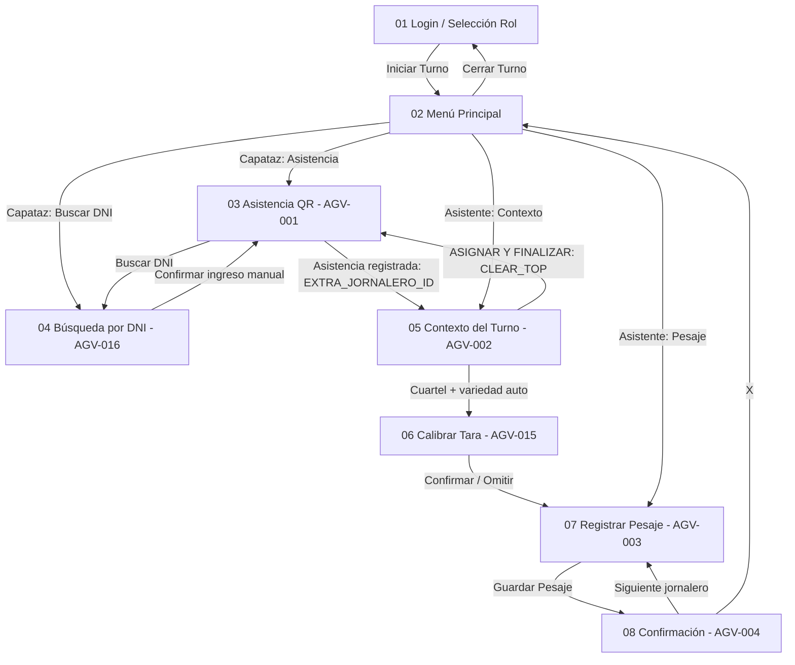

# AgroValle Cosecha — Sprint 1 (MVP · Épica 01: Registro ágil de cosecha a destajo)

## 📱 Descripción del Proyecto

**AgroValle Cosecha** es una aplicación Android **offline-first** para la empresa agroindustrial
AgroValle (Virú/Chao, La Libertad), que digitaliza el registro de **asistencia** y el **pesaje de
jabas de arándano** en campo, sin necesidad de conexión a internet.

Esta rama (`feature/sprint-1-sin-room`) entrega el **Sprint 1 completo**: las 6 historias de usuario
de la Épica 01, con **persistencia en MEMORIA (listas/arreglos)** y las reglas de negocio del backlog.

> **Ajuste según feedback del curso:** en el Sprint 1 **todavía no se usa Room**, porque el tema aún
> no se ha visto en clase. Todo el manejo de datos se hace con **arreglos/listas en memoria**
> (`DatosMemoria`) y el estado en curso con **`SavedStateHandle`**, respetando el diagrama de secuencia.

---

## 🎯 Alcance del Sprint 1 (6 HU · 27 puntos)

| HU | Historia | Estado |
|----|----------|--------|
| **AGV-001** | Asistencia por escaneo QR del fotocheck, con marca horaria exacta, detección de tardanza y rechazo de credenciales inválidas/duplicadas | ✅ Implementado |
| **AGV-002** | Contexto del turno (cuartel → variedad automática) y asignación del jornalero al cuartel | ✅ Implementado |
| **AGV-003** | Pesaje con teclado numérico grande y deducción automática de tara (peso neto) | ✅ Implementado |
| **AGV-004** | Confirmación sonora + vibración + acumulado diario del cosechador | ✅ Implementado |
| **AGV-015** | Calibración de tara al inicio del turno (muestra de 5 jabas vacías) | ✅ Implementado |
| **AGV-016** | Búsqueda de jornalero por los últimos 4 dígitos del DNI (plan B) | ✅ Implementado |

**Tecnologías:** Kotlin · XML Layouts · ViewBinding · **Activities + Intents** · ViewModel ·
**SavedStateHandle** · **Listas/arreglos en memoria** · **ZXing** (lectura real de QR/Code 128).

**NO se usa:** Room/SQLite, KSP, Jetpack Compose, Navigation Component, CameraX, ML Kit, Fragments.

---

## 🏛️ Arquitectura (MVVM con persistencia en MEMORIA)

```
CAPA VISTA (UI)         8 Activities XML + ViewBinding + Material Components
        │  Intent / registerForActivityResult
        ▼
CAPA VIEWMODEL          Asistencia · Contexto · CalibracionTara · Pesaje
        │               + SavedStateHandle (peso bruto, jabas, muestras, cuartel)
        ▼
CAPA MODELO             DatosMemoria (Singleton: listas y mapas en memoria)
                        Jornalero · Asistencia · Pesaje · CalibracionTara
```

**Garantías arquitectónicas:**

1. **Desacoplamiento MVVM**: la UI nunca toca las listas directamente; todo pasa por el ViewModel.
2. **Persistencia en memoria**: `DatosMemoria` (un `object` de Kotlin) es la única fuente de datos,
   tal como exige el curso para el Sprint 1 (listas/arreglos, sin base de datos).
3. **Ciclo crítico < 10 s**: el cálculo del peso neto es inmediato y el formulario se autolimpia.
4. **Estado del turno compartido**: `SesionTurno` (singleton observable) evita que el rol, la jornada
   o el fundo se reinicien al navegar entre pantallas.
5. **Dominio del ciclo de vida**: `SavedStateHandle` conserva el peso en curso, las jabas, las
   muestras de calibración y el cuartel elegido ante rotaciones o muerte del proceso.
6. **Navegación por Intents**: el flujo Asistencia → Contexto se resuelve con
   `putExtra("EXTRA_JORNALERO_ID", id)` y `FLAG_ACTIVITY_CLEAR_TOP` para volver al escaneo.

---

## 📂 Estructura del Código Fuente

```
app/src/main/java/com/agrovalle/cosecha/
├── AgroValleApp.kt                      # Application: solo asegura la carga del padrón en memoria
├── data/
│   └── DatosMemoria.kt                  # SINGLETON con los datos en memoria
│                                        #   listaJornaleros (30), asignaciones, mapaCuarteles,
│                                        #   asistencias, pesajes, calibraciones
├── model/                               # Modelos de dominio (Jornalero, Pesaje, ...)
├── viewmodel/
│   ├── AsistenciaViewModel.kt           # AGV-001 y AGV-016 (+ SavedStateHandle)
│   ├── ContextoViewModel.kt             # AGV-002 (+ SavedStateHandle)
│   ├── CalibracionTaraViewModel.kt      # AGV-015 (+ SavedStateHandle)
│   └── PesajeViewModel.kt               # AGV-003 y AGV-004 (+ SavedStateHandle)
├── view/                                # 8 Activities (pantallas del NavGraph)
└── util/
    ├── Constantes.kt                    # Reglas de negocio parametrizadas
    ├── CalculadoraPesaje.kt             # Cálculos puros (tara y peso neto)
    ├── FechaHoraUtil.kt                 # Marcas horarias y detección de tardanza
    ├── SesionTurno.kt                   # Estado del turno compartido
    └── FeedbackUtil.kt                  # Tono (ToneGenerator) + vibración (Vibrator)
```

---

## 🗄️ Modelo de Datos en Memoria (`DatosMemoria`)

En lugar de tablas, el Sprint 1 usa **colecciones de Kotlin**:

| Colección | Tipo | Contenido |
|-----------|------|-----------|
| `listaJornaleros` | `MutableList<Jornalero>` | **30 jornaleros** precargados (`QR_AGV_001`…`QR_AGV_030`) |
| `asignaciones` | `MutableMap<Long, String>` | Qué jornalero (id) va a qué cuartel |
| `mapaCuarteles` | `Map<String, String>` | Cuartel → variedad (autocompletado de AGV-002) |
| `asistencias` | `MutableList<Asistencia>` | Bitácora de asistencias del turno |
| `pesajes` | `MutableList<Pesaje>` | Pesajes registrados (base del acumulado diario) |
| `calibraciones` | `MutableList<CalibracionTara>` | Historial de calibraciones de tara |

**Mapa de cuarteles → variedad** (autocompletado):

| Cuartel | Variedad |
|---------|----------|
| Cuartel 01 | Biloxi |
| Cuartel 05 | Ventura |
| Cuartel 12 | Biloxi |
| Cuartel 18 | Ventura |

**Reglas garantizadas por `DatosMemoria`:**

- `registrarAsistencia()` devuelve `null` si el jornalero ya se registró ese día (**no duplicados**).
- `buscarJornaleroPorQr()` rechaza códigos que no están en el padrón (**credencial inválida**).
- Los IDs se asignan con un contador interno (`secuenciaAsistencia`, etc.).

> ⚠️ **El estado vive mientras el proceso de la app siga vivo.** Al cerrar la aplicación por
> completo (o matar el proceso) la información en memoria se reinicia: eso es **lo esperado** en el
> Sprint 1. La persistencia en disco se abordará en un sprint posterior con Room.

---

## ⚙️ Reglas de Negocio Implementadas

1. **Marca horaria exacta** `HH:mm:ss` al registrar la asistencia.
2. **Tardanza**: ingreso ≥ 06:15 (jornada mañana) o ≥ 14:15 (jornada tarde) se registra como `TARDANZA`.
3. **Credencial inválida**: un QR que no pertenece al padrón es rechazado con alerta sensorial.
4. **Duplicados**: un jornalero no puede registrar asistencia dos veces el mismo día.
5. **Variedad automática**: al elegir el cuartel se completa la variedad desde `mapaCuarteles`
   (ya no se selecciona manualmente ni se pide el CLP).
6. **Asignación persistente en memoria**: "ASIGNAR Y FINALIZAR" guarda jornalero → cuartel en
   `DatosMemoria.asignaciones` y vuelve al escaneo con `FLAG_ACTIVITY_CLEAR_TOP`.
7. **Peso Neto** = `Peso Bruto − (Tara × Jabas)`, nunca negativo.
8. **Validación de rango**: peso bruto válido entre `0.10` y `60.00` kg (anti errores de tipeo).
9. **Acumulado diario**: suma de los pesajes del día del cosechador (recorrido de `pesajes`).
10. **Calibración de tara**: promedio de 5 jabas; válida solo si cae en `0.350–0.400` kg.

---

## 🔄 Flujo de Navegación (NavGraph Sprint 1)



---

## 🚀 Compilar y Ejecutar

```bash
# 1. Situarse en la rama del Sprint 1
git checkout feature/sprint-1-sin-room

# 2. Compilar
./gradlew assembleDebug

# 3. Instalar en emulador o dispositivo físico
./gradlew installDebug
```

**Requisitos:** Android Studio con **JDK 17+** (AGP 8.2.1), Android SDK 34, minSdk 24.

> Al haber eliminado Room y KSP, la compilación es **más rápida** y ya no hay procesamiento de
> anotaciones ni generación de esquemas.

---

## 🧪 Cómo Probar el Flujo Completo

1. **Login**: rol *Capataz de Cuadrilla*, jornada *Mañana*, fundo *Principal Virú* → **Iniciar Turno**.
2. **Asistencia (AGV-001)**: pulsar **Escanear QR** y apuntar a un QR que contenga `QR_AGV_001`
   (el padrón precargado tiene `QR_AGV_001` … `QR_AGV_030`). Aparece el Toast
   **"Asistencia registrada"** y se abre automáticamente el **Contexto Agronómico**.
   - *Sin fotocheck físico*: genera un QR con el texto `QR_AGV_001` en cualquier generador web.
3. **Contexto (AGV-002)**: elige un cuartel (p. ej. **Cuartel 05**) y verás que la variedad se
   completa sola con **Ventura**. Pulsa **ASIGNAR Y FINALIZAR**: vuelve al escaneo para el siguiente.
   - Verifica el contador: sube a `1 / 30` (el padrón en memoria tiene 30 jornaleros) y el jornalero
     queda asignado en `DatosMemoria.asignaciones`.
4. **Plan B (AGV-016)**: pulsar **Buscar por DNI**, ingresar los últimos 4 dígitos de un jornalero
   del padrón (p. ej. `1234`) y **Confirmar Asistencia** → queda como ingreso manual y navega igual
   al Contexto Agronómico.
5. **Calibrar Tara (AGV-015)**: registrar las **5 muestras** y **Confirmar Calibración**
   (o **Omitir** para usar la tara por defecto de 0.375 kg).
6. **Pesaje (AGV-003)**: escanear el fotocheck, ingresar jabas con `+1` `+4` `+6` y el peso bruto
   (p. ej. **4 jabas** y **9.50 kg** → peso neto **8.00 kg**). Pulsar **Guardar Pesaje**.
7. **Confirmación (AGV-004)**: verifica el tono + vibración, el peso neto y el **acumulado diario**.
   Pulsar **Siguiente Jornalero** para el ciclo continuo.

**Permiso de cámara:** al pulsar **Escanear QR** (o **Escanear Fotocheck** en el Pesaje), la app
verifica el permiso `CAMERA` y lo solicita con `ActivityResultContracts.RequestPermission()`. Si se
**deniega**, muestra un Toast explicativo y **no se cierra**; en la pantalla de asistencia el plan B
por DNI sigue disponible.

**Checklist de pruebas:** el plan de pruebas de funcionamiento del Sprint 1 (60 casos) está en
[`AgroValle-Cosecha-Checklist-Pruebas-Sprint1.md`](../AgroValle-Cosecha-Checklist-Pruebas-Sprint1.md).

**Prueba del ciclo de vida:** en el Pesaje, escribe el peso y las jabas y **gira el teléfono**;
los valores deben conservarse (los guarda `SavedStateHandle`, no la Activity).

---

## ✅ Restricciones Respetadas

- **Sin Room / SQLite**: los datos se manejan con **listas y arreglos en memoria**.
- **Sin KSP**: se quitó el plugin y el procesador de anotaciones.
- **Sin Jetpack Compose**: UI 100% XML + Material Components.
- **Sin Navigation Component**: navegación con `Intent` explícitos y `registerForActivityResult`.
- **Sin CameraX ni ML Kit**: lectura de QR con **ZXing** (`journeyapps`).
- **Solo Activities, Intents, ViewModel y SavedStateHandle** para el manejo de estado.

---

## 🧪 Pruebas Unitarias

En `app/src/test/java/com/agrovalle/cosecha/util/` (33 pruebas en total):

- `CalculadoraPesajeTest` (21): peso neto con 3, 4 y 6 jabas (8.37 / 8.00 / 7.25 kg), neto nunca
  negativo, límites exactos de peso bruto, tara calibrada entre 350 y 400 g (incluidas jabas
  pesadas y livianas fuera de rango) y valor de `TOTAL_CUADRILLA`.
- `FechaHoraUtilTest` (12): conversión de hora a minutos y detección de tardanza en jornada
  mañana (06:15) y tarde (14:15), con casos borde.

**Convención de nombres:** los métodos de test usan **camelCase sin espacios**
(ej. `testPesaje4Jabas()`), **no** comillas invertidas. En Windows, la tarea de Gradle
`testDebugUnitTest` fallaba con `java.lang.ClassNotFoundException` al usar nombres con espacios.

**Aislamiento:** las pruebas solo tocan código puro de Kotlin (`CalculadoraPesaje`,
`FechaHoraUtil`, `Constantes`). **No** se referencia `DatosMemoria` en los tests, porque al
inicializarse arrastra dependencias del framework de Android y rompe la ejecución en la JVM.

Para ejecutarlas:

```bash
./gradlew testDebugUnitTest
```


---

## ⚠️ Fuera del Alcance del Sprint 1 (planificado para Sprints 2–4)

- Persistencia en disco con Room/SQLite (cuando se dicte el tema en el curso).
- Sellado de parihuela con ID/QR e inmutabilidad (AGV-006/007/009 — Sprint 2).
- Cronómetro de retención de 45 min (AGV-008 — Sprint 2).
- Panel resumen del capataz (AGV-005 — Sprint 3).
- Sincronización con el ERP (AGV-013) y reporte de cierre (AGV-014 — Sprint 4).
- Reclamos de peso con pesaje compensatorio (escenarios 2 y 3 de AGV-015).
- Diseño alternativo para orientación horizontal (`layout-land`).
