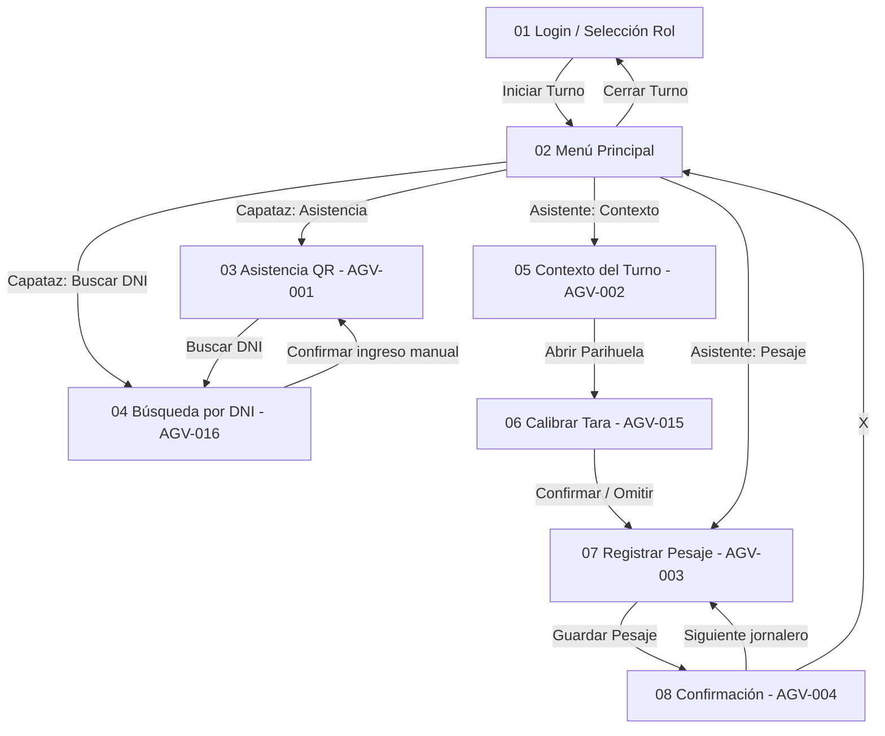

# AgroValle Cosecha — Sprint 1 (MVP · Épica 01: Registro ágil de cosecha a destajo)

## 📱 Descripción del Proyecto

**AgroValle Cosecha** es una aplicación Android **offline-first** para la empresa agroindustrial
AgroValle (Virú/Chao, La Libertad), que digitaliza el registro de **asistencia** y el **pesaje de
jabas de arándano** en campo, sin necesidad de conexión a internet.

Esta rama (`feature/sprint-1-completo`) entrega el **Sprint 1 completo**: las 6 historias de usuario
de la Épica 01, con **persistencia local real en Room** y las reglas de negocio del backlog.

---

## 🎯 Alcance del Sprint 1 (6 HU · 27 puntos)

| HU | Historia | Estado |
|----|----------|--------|
| **AGV-001** | Asistencia por escaneo QR del fotocheck, con marca horaria exacta, detección de tardanza y rechazo de credenciales inválidas/duplicadas | ✅ Implementado |
| **AGV-002** | Contexto del turno (cuartel, CLP, variedad) y parihuela activa | ✅ Implementado |
| **AGV-003** | Pesaje con teclado numérico grande y deducción automática de tara (peso neto) | ✅ Implementado |
| **AGV-004** | Confirmación sonora + vibración + acumulado diario del cosechador | ✅ Implementado |
| **AGV-015** | Calibración de tara al inicio del turno (muestra de 5 jabas vacías) | ✅ Implementado |
| **AGV-016** | Búsqueda de jornalero por los últimos 4 dígitos del DNI (plan B) | ✅ Implementado |

**Tecnologías:** Kotlin · XML Layouts · ViewBinding · Activities + Intents · ViewModel ·
**Room (SQLite)** · Corrutinas · **ZXing** (lectura real de QR/Code 128).

---

## 🏛️ Arquitectura (MVVM + Room)

```
CAPA VISTA (UI)         8 Activities XML + ViewBinding + Material Components
        │  eventos
        ▼
CAPA VIEWMODEL          Asistencia · Contexto · CalibracionTara · Pesaje
        │  corrutinas (Dispatchers.IO)
        ▼
CAPA MODELO             Room: 6 entidades + 6 DAOs + AgroValleRepository
```

**Garantías arquitectónicas:**

1. **Desacoplamiento MVVM**: la UI nunca ejecuta SQL; todo pasa por el ViewModel y el repositorio.
2. **Ciclo crítico < 10 s**: el cálculo del peso neto es inmediato y el formulario se autolimpia.
3. **Operación offline pura**: Room/SQLite garantiza persistencia local sin internet.
4. **Estado del turno compartido**: `SesionTurno` (singleton observable) evita que el rol, la jornada
   o el fundo se reinicien al navegar entre pantallas.

---

## 📂 Estructura del Código Fuente

```
app/src/main/java/com/agrovalle/cosecha/
├── AgroValleApp.kt                      # Application: BD + repositorio + precarga del padrón
├── data/
│   ├── local/
│   │   ├── AgroValleDatabase.kt         # RoomDatabase (6 entidades, versión 1)
│   │   ├── PadronSeeder.kt              # Precarga 1 cuadrilla + 30 jornaleros
│   │   ├── entity/                      # Cuadrilla, Jornalero, Asistencia,
│   │   │                                # Parihuela, Pesaje, CalibracionTara
│   │   └── dao/                         # 6 DAOs (suspend + Flow/consultas)
│   ├── mapper/Mappers.kt                # Entidad (Room) -> modelo de dominio
│   └── repository/AgroValleRepository.kt# Acceso único a datos + transacción atómica
├── model/                               # Modelos de dominio (Jornalero, Pesaje, ...)
├── viewmodel/
│   ├── AsistenciaViewModel.kt           # AGV-001 y AGV-016
│   ├── ContextoViewModel.kt             # AGV-002
│   ├── CalibracionTaraViewModel.kt      # AGV-015
│   └── PesajeViewModel.kt               # AGV-003 y AGV-004
├── view/                                # 8 Activities (pantallas del NavGraph)
└── util/
    ├── Constantes.kt                    # Reglas de negocio parametrizadas
    ├── FechaHoraUtil.kt                 # Marcas horarias y detección de tardanza
    ├── SesionTurno.kt                   # Estado del turno compartido
    └── FeedbackUtil.kt                  # Tono (ToneGenerator) + vibración (Vibrator)
```

---

## 🗄️ Modelo de Datos (Room)

| Tabla | Campos principales |
|-------|--------------------|
| `cuadrillas` | `id`, `codigo` (único), `nombre_supervisor`, `fundo_cuartel` |
| `jornaleros` | `id`, `dni` (índice), `codigo_qr` (único), `nombres`, `apellidos`, `cuadrilla_codigo` (FK) |
| `asistencias` | `id`, `jornalero_id` (FK), `fecha`, `hora_ingreso`, `estado` (PUNTUAL/TARDANZA), `metodo` (QR_SCAN/DNI_MANUAL) |
| `parihuelas` | `id`, `codigo_marbete`, `cuartel`, `variedad`, `clp`, `total_jabas`, `estado` (ABIERTA/SELLADA) |
| `entregas_pesaje` | `id`, `jornalero_id` (FK), `parihuela_id` (FK), `cantidad_jabas`, `peso_bruto`, `tara_total`, `peso_neto`, `timestamp`, `es_tara_defecto` |
| `calibraciones` | `id`, `tara_promedio_calculada`, `peso_muestra_5_jabas`, `asistente_nombre`, `timestamp`, `aprobado` |

Restricciones: FK con `CASCADE`/`SET_NULL`, índice **único** `(jornalero_id, fecha)` en asistencias
(impide duplicar la asistencia del día) e índice único de `codigo_qr` en el padrón.

---

## ⚙️ Reglas de Negocio Implementadas

1. **Marca horaria exacta** `HH:mm:ss` al registrar la asistencia.
2. **Tardanza**: ingreso ≥ 06:15 (jornada mañana) o ≥ 14:15 (jornada tarde) se registra como `TARDANZA`.
3. **Credencial inválida**: un QR que no pertenece al padrón es rechazado con alerta sensorial.
4. **Duplicados**: un jornalero no puede registrar asistencia dos veces el mismo día.
5. **Peso Neto** = `Peso Bruto − (Tara × Jabas)`, nunca negativo.
6. **Validación de rango**: peso bruto válido entre `0.10` y `60.00` kg (anti errores de tipeo).
7. **Persistencia atómica**: el pesaje y la suma de jabas a la parihuela se guardan en una sola
   transacción (`withTransaction`).
8. **Acumulado diario**: suma de los pesajes del día del cosechador (consulta `SUM` a Room).
9. **Calibración de tara**: promedio de 5 jabas; válida solo si cae en `0.350–0.400` kg.
10. **Contexto bloqueado**: con una parihuela ABIERTA no se puede cambiar cuartel/CLP/variedad.

---

## 🔄 Flujo de Navegación (NavGraph Sprint 1)



---

## 🚀 Compilar y Ejecutar

```bash
# 1. Situarse en la rama del Sprint 1
git checkout feature/sprint-1-completo

# 2. Compilar
./gradlew assembleDebug

# 3. Instalar en emulador o dispositivo físico
./gradlew installDebug
```

**Requisitos:** Android Studio con **JDK 17+** (AGP 8.2.1), Android SDK 34, minSdk 24.

---

## 🧪 Cómo Probar el Flujo Completo

1. **Login**: rol *Capataz de Cuadrilla*, jornada *Mañana*, fundo *Principal Virú* → **Iniciar Turno**.
2. **Asistencia (AGV-001)**: pulsar **Escanear QR** y apuntar a un QR que contenga `QR_AGV_001`
   (el padrón precargado tiene `QR_AGV_001` … `QR_AGV_030`). El contador sube a `1 / 35`.
   - *Sin fotocheck físico*: genera un QR con el texto `QR_AGV_001` en cualquier generador web.
3. **Plan B (AGV-016)**: pulsar **Buscar por DNI**, ingresar los últimos 4 dígitos de un jornalero
   del padrón (p. ej. `1234`) y **Confirmar Asistencia** → queda como ingreso manual.
4. **Contexto (AGV-002)**: volver al menú, cambiar a rol *Asistente*, entrar a **Contexto del Turno**,
   elegir Cuartel, CLP y Variedad, y **Abrir Parihuela**.
5. **Calibrar Tara (AGV-015)**: registrar las **5 muestras** y **Confirmar Calibración**
   (o **Omitir** para usar la tara por defecto de 0.375 kg).
6. **Pesaje (AGV-003)**: escanear el fotocheck, ingresar jabas con `+1` `+4` `+6` y el peso bruto
   (p. ej. **4 jabas** y **9.50 kg** → peso neto **8.00 kg**). Pulsar **Guardar Pesaje**.
7. **Confirmación (AGV-004)**: verifica el tono + vibración, el peso neto y el **acumulado diario**.
   Pulsar **Siguiente Jornalero** para el ciclo continuo.

---

## ✅ Restricciones Respetadas

- **Sin Jetpack Compose**: UI 100% XML + Material Components.
- **Sin Navigation Component**: navegación con `Intent` explícitos y `registerForActivityResult`.
- **Sin CameraX ni ML Kit**: lectura de QR con **ZXing** (`journeyapps`).
- **Con Room/SQLite**: persistencia local exigida por el Sprint Backlog.

---

## ⚠️ Fuera del Alcance del Sprint 1 (planificado para Sprints 2–4)

- Sellado de parihuela con ID/QR e inmutabilidad (AGV-006/007/009 — Sprint 2).
- Cronómetro de retención de 45 min (AGV-008 — Sprint 2).
- Panel resumen del capataz (AGV-005 — Sprint 3).
- Sincronización con el ERP (AGV-013) y reporte de cierre (AGV-014 — Sprint 4).
- Reclamos de peso con pesaje compensatorio (escenarios 2 y 3 de AGV-015).
- Diseño alternativo para orientación horizontal (`layout-land`).
