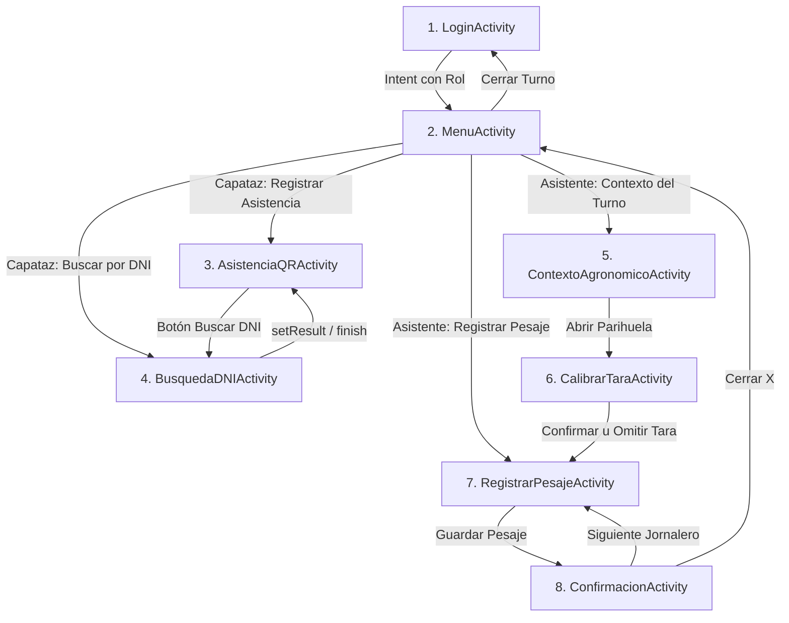

# AgroValle Cosecha - Sprint 1 (Coder 2: UI & Navegación)

## 📱 Descripción del Proyecto

**AgroValle Cosecha** es un sistema móvil desarrollado para la empresa agroindustrial AgroValle en Virú/Chao (La Libertad, Perú), diseñado para el registro ágil de asistencia y pesaje de jabas de arándano en condiciones de campo sin conectividad (offline-first).

Esta rama (`feature/ui-navegacion`) contiene la implementación exclusiva del rol **Coder 2**, enfocado en la interfaz gráfica tradicional basada en **XML Layouts**, navegación mediante **Intents explícitos**, **ViewBinding** y persistencia de estado ante rotación con **ViewModel + SavedStateHandle**.

---

## 🏛️ Restricciones y Arquitectura Cumplidas (Cero Tolerancia)

1. **PROHIBIDO Jetpack Compose**: Implementación 100% nativa en XML clásico con Material Components (`MaterialButton`, `MaterialCardView`, `ConstraintLayout`, `GridLayout`).
2. **PROHIBIDO Navigation Component**: Navegación desacoplada exclusivamente mediante `Intent` explícitos entre las 8 Activities.
3. **PROHIBIDO Room / SQLite**: Modelos base desacoplados preparados en stubs listos para la integración con Coder 1.
4. **PROHIBIDO CameraX / ML Kit**: Placeholder visual de visor (`FrameLayout` con marco y vector QR) simulando escaneo táctil de fotochecks.
5. **OBLIGATORIO ViewBinding**: Activado en `build.gradle.kts` e implementado en cada Activity (`ActivityXBinding.inflate(layoutInflater)`).
6. **OBLIGATORIO ViewModel con SavedStateHandle**: `TurnoViewModel` retiene roles, jornadas, conteo de asistencia, tara y acumulado diario sobreviviendo a recreaciones de pantalla por rotación.
7. **SDK Mínimo**: API 24 (Android 7.0), compilado para API 34.

> ⚠️ **Estado compartido del turno (pendiente con Coder 1):** el contador de asistencia, la tara calibrada, el acumulado diario y el estado de la parihuela son locales a cada Activity por ahora. Se integrará un repositorio singleton (`TurnoRepository`) implementado por Coder 1 (Diego) para compartirlos entre pantallas; la UI ya está preparada para consumirlo.

---

## 📂 Estructura del Código Fuente

```
app/src/main/java/com/agrovalle/cosecha/
├── model/                               # Entidades base (stubs desacoplados)
│   ├── Jornalero.kt
│   ├── Asistencia.kt
│   ├── Parihuela.kt
│   ├── Pesaje.kt
│   └── CalibracionTara.kt
├── viewmodel/
│   └── TurnoViewModel.kt                # SavedStateHandle (sobrevive rotación de pantalla)
├── view/                                # 8 Activities del Sprint 1
│   ├── LoginActivity.kt                 # 1. Configuración de turno (Launcher)
│   ├── MenuActivity.kt                  # 2. Menú modular por rol (Capataz / Asistente)
│   ├── AsistenciaQRActivity.kt          # 3. Visor QR y contador de cuadrilla (0/35)
│   ├── BusquedaDNIActivity.kt           # 4. Teclado numérico táctil y búsqueda manual
│   ├── ContextoAgronomicoActivity.kt    # 5. Cuartel, CLP, Variedad y apertura de parihuela
│   ├── CalibrarTaraActivity.kt          # 6. Muestreo de 5 jabas y promedio de tara
│   ├── RegistrarPesajeActivity.kt       # 7. Peso bruto, jabas (+1, +4, +6) y peso neto
│   └── ConfirmacionActivity.kt          # 8. Confirmación con feedback sensorial
└── util/
    └── FeedbackUtil.kt                  # Sonido (ToneGenerator) y vibración (Vibrator)

app/src/main/res/layout/
├── activity_login.xml
├── activity_menu.xml
├── activity_asistencia_qr.xml
├── activity_busqueda_dni.xml
├── activity_contexto.xml
├── activity_calibrar_tara.xml
├── activity_registrar_pesaje.xml
└── activity_confirmacion.xml
```

---

## 🔄 Flujo de Navegación y Pantallas



---

## 🎨 Paleta de Colores y Recursos
- **Verde Agrícola**: `#1E4D2B`
- **Verde Oscuro**: `#14361E`
- **Verde Claro / Acento**: `#A3D9B1`
- **Verde Fondo Suave**: `#E8F5E9`
- **Fondo de la App**: `#F8FAF9`
- **Alerta / Tara por Defecto**: `#F57C00` / `#FFFDE7`

---

## 🚀 Pasos para Ejecutar y Probar

1. **Clonar y situarse en la rama**:
   ```bash
   git checkout feature/ui-navegacion
   ```

2. **Compilar el proyecto**:
   ```bash
   ./gradlew assembleDebug
   ```

3. **Instalar en emulador o dispositivo físico**:
   ```bash
   ./gradlew installDebug
   ```

4. **Flujo de prueba recomendado**:
   - **Login**: Seleccionar "Capataz de Cuadrilla", presionar "Iniciar Turno".
   - **Asistencia**: Pulsar "Registrar Asistencia". Tocar "Escanear QR" para verificar incremento del contador (0/35 -> 1/35) y vibración háptica.
   - **Búsqueda DNI**: Pulsar "Buscar por DNI", usar el teclado numérico ingresando `1234` y presionar "Buscar" -> "Confirmar Asistencia".
   - **Contexto**: Regresar al Menú, cambiar rol o acceder a "Contexto del Turno". Seleccionar Cuartel, CLP y Variedad Biloxi para habilitar "Abrir Parihuela".
   - **Calibrar Tara**: Registrar las 5 muestras para habilitar "Confirmar Calibración", o presionar "Omitir y Usar Tara 0.375 kg".
   - **Registrar Pesaje**: Tocar el visor para identificar al jornalero Luis Pérez. Ajustar jabas con los botones rápidos `+1`, `+4`, `+6`. Observar el cálculo de Peso Neto en tiempo real. Presionar "Guardar Pesaje".
   - **Confirmación**: Se activa sonido y vibración haptic. Presionar "Siguiente Jornalero" para limpiar campos y continuar.
